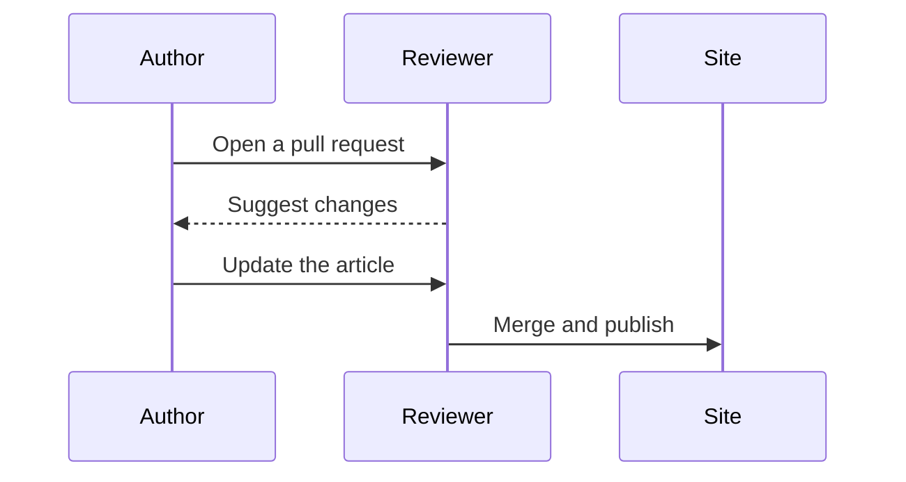

Every article here starts with a picture. If you can't draw the idea yet, that usually means you don't understand it yet, and working that out is the reason to write it down.

## Pick one idea

Choose something small enough for a single diagram. "How a cache stampede happens" works. "Caching" doesn't.

## Draw it first

Use whatever is quickest. For a sequence of steps, a Mermaid code fence is often enough:

For something more visual, draw it in the editor at `/write`, or add an SVG to `public/diagrams/` and place it anywhere in the text:

<Diagram src="/diagrams/how-an-article-ships.svg" caption="The same diagram as the top of this page, placed inline." />

## Then explain the picture

Walk through the diagram in the order someone would read it. Say what each part does and why it's there. Anything the diagram doesn't need can probably be cut.

## Publish it

Add your file to `content/articles/` and open a pull request. [CONTRIBUTING.md](https://github.com/Tochi-Onwuasoanya/picture-books/blob/main/CONTRIBUTING.md) has the details, including one MDX gotcha worth knowing about.
